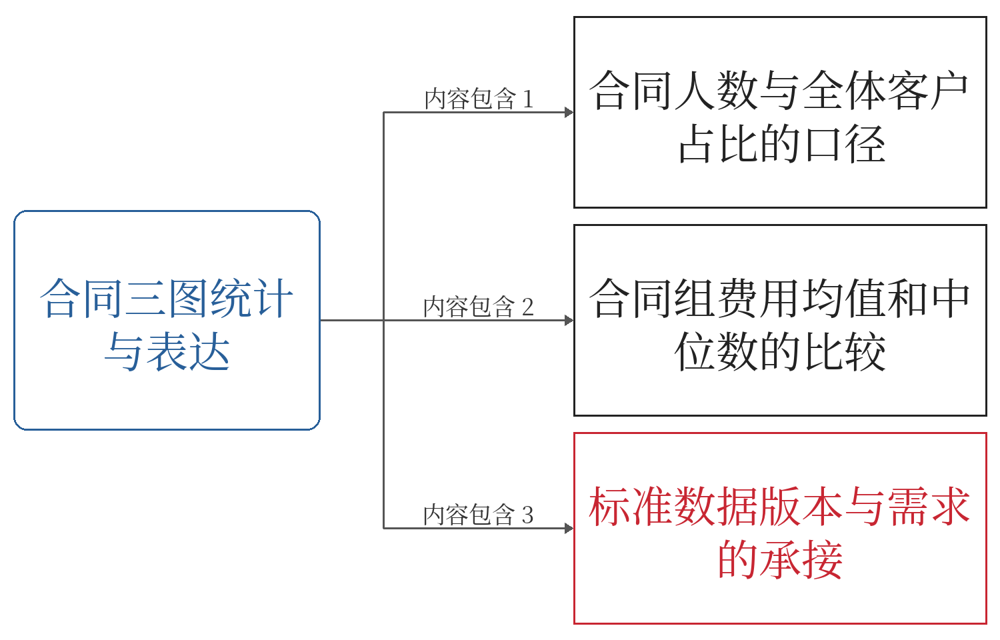
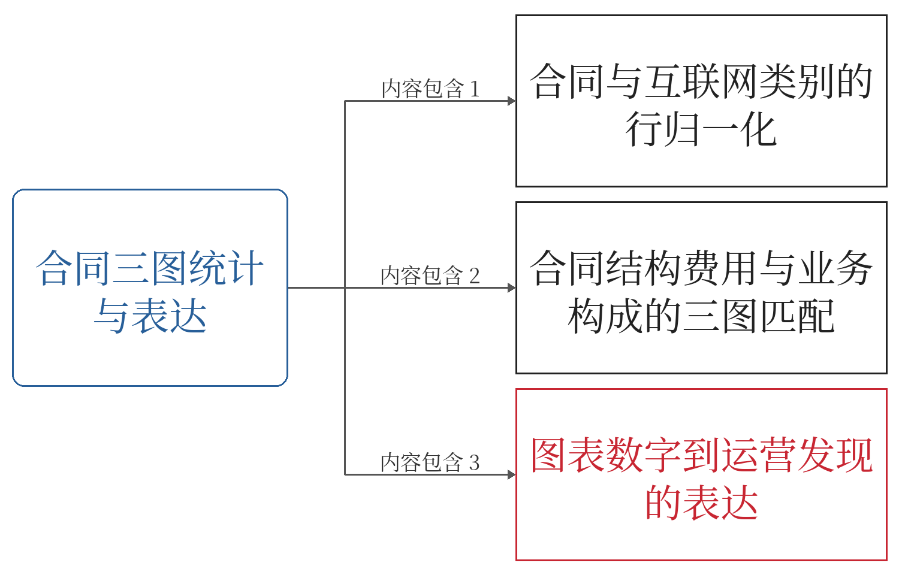

# 项目化教学设计与知识建模 Skill

用于按学校原始模板编写和修订项目化课程教学设计，围绕岗位任务梳理知识、学习目标、活动、资源、成果和评价。

## 适用任务

- 将按课次编写的教案重组为按项目编写的教学设计。
- 绘制项目总知识图、活动图和任务知识组块，核对语义关系及编号。
- 核对课上课下、活动、任务与师生交互分段的时间。
- 按实际策略细化讨论、演示、汇报、反馈及修订过程。
- 保留学校模板的栏目、列宽和合并单元格，每项目整理一次教学反思。

## 文件说明

Skill本体位于 `build-project-teaching-design/`。

| 路径 | 内容 |
| --- | --- |
| `SKILL.md` | 核心工作流程、复用边界与交付要求 |
| `agents/openai.yaml` | 显示名称、简介、默认提示及界面配置 |
| `references/` | 需求、模板、知识图、目标、交互与常见问题说明 |
| `scripts/audit_design.py` | 检查共享设计数据中的时间、目标、资源与知识关系等结构 |
| `scripts/audit_template.py` | 检查DOCX表格网格、跨列与纵向合并结构 |
| `assets/` | 学校模板、建模参考资料、交互参考图、项目一示例数据及模板结构配置 |

本目录包含规则、资源与示例，不包含项目一至七全部教学成品。项目一示例参数不能直接套用到其他项目。

## 使用方式

1. 在支持Skills的工具中，按该工具的安装方式导入完整的 `build-project-teaching-design` 文件夹。
2. 提供本次学校模板、实施方案、进度、任务书、评价标准及批注稿。
3. 明确课程、项目、学时、交付件和本次修订范围。
4. 调用Skill完成设计，并核对时间、结构、语义及渲染结果。

示例提示：

> 使用 build-project-teaching-design，先读取本次模板和批注，仅修订项目三的师生交互与任务知识组块。保留已经确认的教学内容，核对目标、任务、资源、成果和评价的对应，以及课上课下时间。

## 检查脚本

以下命令在Skill文件夹内执行；两个检查脚本使用Python标准库。

```bash
python scripts/audit_design.py DATA.json --class-minutes N --home-minutes M --core NODE_ID
```

`DATA.json`须按示例结构准备，时间和节点ID替换为实际值。

```bash
python scripts/audit_template.py assets/school-template.docx OUTPUT.docx --profile assets/template-profile.json --task-counts 2 2 2 2 2 2
```

任务数量、输出文件与模板profile按实际项目替换。脚本执行不等于完成专业语义、视觉排版或原生Visio打开验证。

## 应用情况

本Skill已用于《数据可视化》项目一至项目七教学设计与知识建模的迭代修订，沉淀模板保留、具体知识目标选取、思政映射、编号交互与知识组块切分等规则。

教师负责教学内容判断、资料授权与最终审定。无真实课堂记录时，不生成虚构的学生表现、完成率或教学效果。

## 应用案例：项目三

通信客户画像与运营分析可视化，12学时。
案例包含教学设计、知识建模图、任务知识组块及可编辑Visio文件。

### 完整材料
- [查看教学设计PDF](examples/project-03/teaching-design.pdf)
- [查看完整知识建模图PDF](examples/project-03/knowledge-model.pdf)
- [浏览全部案例文件](examples/project-03/)

### 活动一：任务知识组块展示

#### 任务一


#### 任务二

